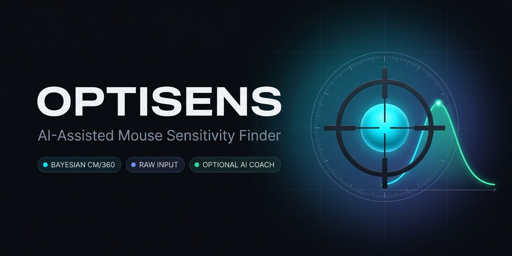
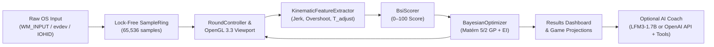

<div align="center">
  
  <br /><br />

  <p>
    
    
    
    
    
    
  </p>

  <p>
    <a href="https://github.com/arefabacworkshop/OPTISENS/releases/tag/OPTISENSE">
      
    </a>
  </p>

  <p>
    <a href="#features">Features</a> •
    <a href="#installation">Installation</a> •
    <a href="#quick-start">Quick Start</a> •
    <a href="#architecture">Architecture</a> •
    <a href="docs/USER_GUIDE.md">User Guide</a> •
    <a href="docs/INSTALLATION.md">Install Guide</a> •
    <a href="docs/ARCHITECTURE.md">Architecture Docs</a>
  </p>
</div>

---

**OPTISENS** scientifically finds your optimal physical mouse sensitivity (`cm/360`) using raw OS mouse telemetry, real-time 3D aiming scenarios, biomechanical kinematic scoring, Gaussian-process Bayesian optimization, and an **optional** AI coach (offline local `LFM3-1.7B` or any OpenAI-compatible API).

Instead of guessing numbers or copying pro settings, OPTISENS measures how smoothly and accurately *your* hand moves across your mousepad—then recommends your ideal `cm/360` and converts it into exact in-game values for **CS2 / Source**, **Valorant / Unreal**, **Overwatch 2**, and **Call of Duty**.

---

## Features

| Capability | What It Does |
| :--- | :--- |
| **True Physical `cm/360` Calibration** | Measures sensitivity in physical centimeters per 360° turn—invariant to DPI, monitor resolution, and game engine. |
| **Zero-Acceleration Raw Input** | Captures sub-millisecond hardware counts directly from Win32 `WM_INPUT` (Windows), `evdev` (Linux), and `IOHIDManager` (macOS). |
| **3D OpenGL 3.3 Aim Scenarios** | Tests three core aiming primitives per round: **Smooth Tracking** (15s), **Reactive Flick** (15s), and **Precision Micro-Dot** (10s). |
| **Biomechanical Skill Index (BSI)** | Computes normalized smoothness (jerk), flick overshoot/undershoot ($E_{\text{flick}}$), micro-adjustment settling time ($T_{\text{adjust}}$), and accuracy. |
| **Bayesian Sensitivity Search** | Uses a Matérn 5/2 Gaussian Process with Expected Improvement (EI) and fatigue modeling to converge in up to 6 rounds. |
| **Optional AI Coach (`LFM3-1.7B` or OpenAI API)** | Use OPTISENS 100% without AI, download the offline `LFM3-1.7B-ONNX` model, or connect any OpenAI-compatible endpoint (OpenAI, OpenRouter, Ollama, LM Studio) with streaming & tool-calling. |
| **First-Run Setup & Asset Bootstrapper** | Choose your data folder, toggle AI Coach on or off, test OpenAI-compatible endpoints live, or download/verify local model files with live speed & ETA. |
| **Animated Calibration Test Guide** | Native 60fps looping visual demos for **Smooth Tracking**, **Reflex Flicks**, and **Micro-Dots** plus in-session HUD action cues (`NO CLICK` vs `LEFT-CLICK`). |

---

## Installation

### Windows (Prebuilt `.msi` Installer — Recommended)

Download the latest Windows `.msi` installer from the **[GitHub Releases page](https://github.com/arefabacworkshop/OPTISENS/releases/tag/OPTISENSE)** and run it—no `.NET` runtime installation required.

To build the Windows installers from source:

```powershell
# Build .msi installer (WiX v5) -> dist/installer/OPTISENS-0.5.8-win-x64.msi
powershell -ExecutionPolicy Bypass -File packaging/windows/build-msi.ps1

# Or build Inno Setup .exe wizard -> dist/installer/OPTISENSSetup-0.5.8-win-x64.exe
powershell -ExecutionPolicy Bypass -File packaging/windows/build-setup.ps1
```

### Linux & macOS (One-Command Terminal Installer)

```bash
bash scripts/install.sh
```

The interactive terminal installer publishes `OPTISENS.App`, installs the application and desktop/dock shortcuts, checks raw-input permissions (`udev` on Linux, Input Monitoring prompt on macOS), and launches OPTISENS.

> For `.deb`, `.AppImage`, `.pkg`, and `.dmg` packaging instructions, see the **[Installation & Packaging Guide](docs/INSTALLATION.md)**.

---

## Quick Start

### 1. Build & Test from Source

Requires the **.NET 10 SDK** (or newer with `rollForward` configured in [global.json](global.json)).

```bash
dotnet build OPTISENS.sln
dotnet test OPTISENS.sln
```

### 2. Run the Application

```bash
dotnet run --project src/OPTISENS.App -- --dev
```

### 3. Calibration Flow

1. **First-Run Setup** — Pick your data/assets folder, then choose whether to **enable AI Coach** or continue **without AI**. If enabled, either download **Local AI (`LFM3-1.7B-ONNX`)** or connect an **OpenAI-compatible API** (`OpenAI`, `Ollama`, `LM Studio`, or custom URL). You can change this anytime via **AI Settings**.
2. **Hardware Profile** — Enter your **Mouse DPI**, **Usable Mousepad Width (cm)**, and **Grip Style** (with an optional live DPI & raw-input swipe check).
3. **Animated Test Guide** — Before your first calibration (and anytime via **How Tests Work**), step through 60fps visual demos of **Smooth Tracking** (no clicking), **Reflex Flicks** (snap + left-click), and **Micro-Dots** (micro-aim + left-click).
4. **Calibration Session** — Complete up to 6 adaptive rounds (Tracking → Flick → Micro-Dot with short rest intervals). OPTISENS locks the cursor and probes candidate `cm/360` values chosen by Bayesian optimization.
5. **Results & AI Coach** — Inspect your recommended `cm/360`, confidence band, Gaussian Process curve, per-round kinematic table, and (if enabled) chat with the AI Coach.

---

## CLI Reference

| Flag | Description |
| :--- | :--- |
| `--model-dir <path>` | Override the AI Coach model directory (defaults to saved `settings.json` path, `$XDG_DATA_HOME/optisens/models/LFM3-1.7B-ONNX`, or `<appdir>/models/LFM3-1.7B-ONNX`). |
| `--dev` | Enable the `F12` developer overlay (FPS, raw sample rate, active probe `cm/360`, and $\ge 10\text{ cm}$ physical swipe ruler verification). |
| `--skip-ai` | Launch directly without loading the embedded `LFM3-1.7B-ONNX` model. |

---

## Architecture



| Module | Responsibility |
| :--- | :--- |
| `OPTISENS.Core` | Units (`PhysicalTurnDistance`), raw input ring buffer, kinematic feature extraction, BSI scorer, Matérn 5/2 GP, Expected Improvement optimizer, round state machine, game sensitivity projection, `AppSettings` & `AssetManifest`. |
| `OPTISENS.Ai` | `ICoachSession`, `Lfm3Engine` (ONNX Runtime GenAI), `OpenAiCoachSession` (SSE streaming + tool calls), `Lfm3Tokenizer`, `Lfm3ChatTemplate`, `ToolCallParser`, `ToolDispatcher`, and `CoachSession`. |
| `OPTISENS.Input.Windows` | Win32 `WM_INPUT` raw mouse capture (`RIDEV_INPUTSINK` / message window). |
| `OPTISENS.Input.Linux` | Direct `/dev/input/event*` `evdev` reader with `udev` permission diagnostics. |
| `OPTISENS.Input.Mac` | `IOKit` `IOHIDManager` raw HID mouse delta capture. |
| `OPTISENS.Platform` | Cross-platform cursor lock, unlock, and center helpers. |
| `OPTISENS.App` | Avalonia 11 desktop UI, Silk.NET OpenGL 3.3 3D viewport, GP curve plot control, 60fps `TestGuidePreviewControl`, and First-Run Setup bootstrapper. |

---

## Documentation

- **[User Guide](docs/USER_GUIDE.md)** — Walkthrough of First-Run Setup, Hardware Profile, Calibration Scenarios, Results Dashboard, and AI Coach prompts.
- **[Installation & Packaging Guide](docs/INSTALLATION.md)** — Windows Inno Setup, Linux `.deb` / `AppImage` / `udev`, macOS `.pkg` / `.dmg` / Input Monitoring, and offline model downloads.
- **[Architecture & Math Reference](docs/ARCHITECTURE.md)** — Kinematic metrics, BSI formula, Gaussian Process Bayesian optimization, game sensitivity equations, and AI tool-calling contracts.
- **[Development Log](docs/DEVLOG.md)** — Engineering notes and milestone history.

---

## Licenses

- **Application Code**: See repository license.
- **AI Coach Model (`LiquidAI/LFM3-1.7B-ONNX`)**: Downloaded separately at setup time and governed by the **LFM Open License v1.0** (not MIT).
